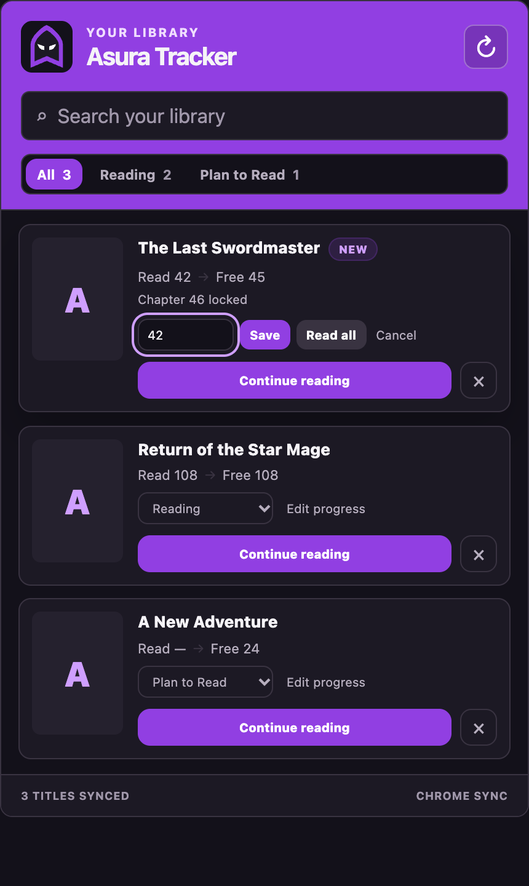

# Asura Reading Tracker

A private Chrome extension that tracks your Asura Scans library and chapter progress. It stores one record per title in Chrome Sync, advances tracked series when you open newer chapters, and shows available updates in the toolbar badge and popup.

## Features

- Track or remove a title from a floating control on Asura series and chapter pages.
- Automatically remember the highest chapter you open without moving backward on rereads.
- Organize titles as Reading, Plan to Read, Completed, On Hold, or Dropped.
- Search, edit progress, continue reading, and refresh latest chapters from the popup.
- Sync the library through your signed-in Chrome profile.
- Survive Asura URL-ID rotations by using the suffix-free series route as the stable identity.
- No Asura login access, analytics, external backend, or periodic background polling.

## Screenshots

The current popup interface with sample titles and chapter data. Cover images use the built-in fallback.

| Library and chapter updates | Edit reading progress |
| --- | --- |
|  |  |

## Build and load in Chrome

Requirements: Node.js 20 or newer and npm.

```bash
npm install
npm run test
npm run build
```

Then open `chrome://extensions`, enable **Developer mode**, select **Load unpacked**, and choose the generated `dist` directory.

After installing, open a URL under `https://asurascans.com/comics/...`. Use the floating **Track** button, visit chapters normally, and open the extension icon to manage your library.

## Development

```bash
npm run dev
npm run typecheck
npm run test:watch
```

Chrome extensions cannot hot-reload every service-worker change reliably. Reload the extension from `chrome://extensions` after background or manifest changes.

## Data and refresh behavior

- Durable title records use `chrome.storage.sync`; refresh timestamps use `chrome.storage.local`.
- Older full-slug records are migrated and deduplicated automatically when the popup or a tracked page is opened.
- Opening the popup refreshes titles not checked in the previous 30 minutes. The refresh button bypasses that cache.
- Refreshes use Asura's stable suffix-free route and adopt its redirect, repairing changed canonical URLs automatically.
- At most three series pages are requested concurrently, with a ten-second timeout per request.
- The badge is the number of tracked titles with a confirmed free chapter newer than your last-read chapter.
- Updates and the badge count only confirmed free chapters newer than saved reading progress. Premium releases appear separately with their unlock countdown when supplied by Asura.
- Asura typically offers six-hour early access, but the extension reads each chapter’s explicit availability and unlock time. Unknown availability never triggers an update.
- Chrome profile startup forces a refresh and shows one desktop summary of titles with free unread chapters. Clicking it opens the library. Failed refreshes are excluded, and no alert appears when nothing qualifies or notifications are disabled.
- Opening another window or waking the extension worker does not trigger a startup summary. Expired unlock times bypass the popup refresh cache for verification.

## Troubleshooting

- **Nothing appears on Asura:** reload the Asura tab after installing or updating the extension.
- **Chrome Sync quota error:** wait for Chrome's write limit to reset or remove unused titles. The extension never silently switches durable data to local-only storage.
- **Refresh unavailable:** Asura may be blocking or unavailable. Page visits still update progress, and the popup can be refreshed later.
- **A tracked page temporarily shows Track:** reload the extension once, then reopen its popup or refresh the Asura tab. Existing progress will be migrated; do not retrack manually.
- **Site layout changes:** route parsing remains the primary fallback, but cover/title extraction may need updating if Asura changes its HTML metadata.
